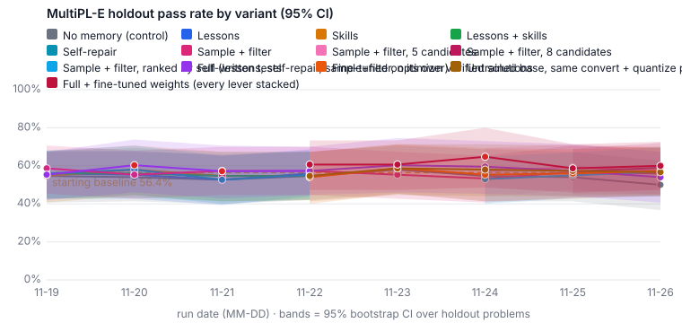
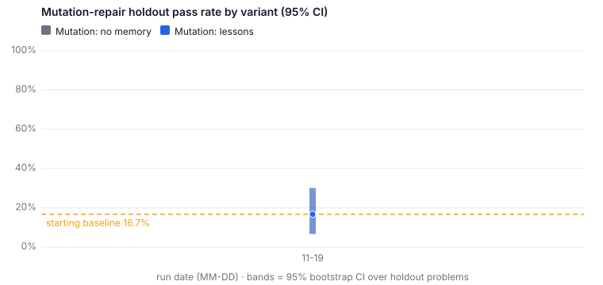
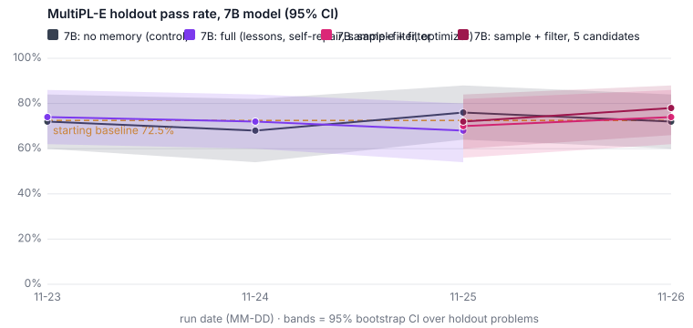

# self-improving-coder

A small open model (`qwen2.5-coder:1.5b`, running free on GitHub Actions via Ollama) tries to get better
at writing JavaScript, one day at a time. It keeps **lessons** from its failures, a library of **skills**
from its successes, and can rewrite its own **system prompt**. Unit tests are the only judge. Every change
has to beat the current version on held-out problems, with a confidence interval, before it is kept.

**[Dashboard](https://mrarun005.github.io/SelfImprovementModelWrapper/)** (GitHub Pages: replays, lesson genealogy, gate log)
· **[REPORT.md](REPORT.md)** (generated from the data, bad news included)
· **[docs/power.md](docs/power.md)** (what effect sizes this setup can detect)
· **[DECISIONS.md](DECISIONS.md)** (every non-obvious choice)





## Results

<!-- report:summary:start -->
_Generated by `npm run report` from the committed state (217 evaluated runs, last 2026-11-26). Details: [REPORT.md](REPORT.md)._

**MultiPL-E (HumanEval + MBPP, JavaScript), 1.5B model**: points vs the control on the same day, best first (control at 50.0%).

| Variant | Pass rate | vs control (today) | 95% CI | p (Holm) | pooled vs control (last 7 days) | pooled 95% CI | pooled p (Holm) |
|---|---|---|---|---|---|---|---|
| Sample + filter, 5 candidates | 58.7% | +8.7 pts | +2.7 pts to +15.3 pts | 0.036 (significant) | +3.4 pts (7 d) | +0.5 pts to +7.0 pts | 0.242 |
| Sample + filter, 8 candidates | 57.0% | +7.0 pts | +2.0 pts to +13.0 pts | 0.044 (significant) | +3.4 pts (7 d) | +0.8 pts to +6.5 pts | 0.084 |
| Full + fine-tuned weights (every lever stacked) (stopped) | 60.0% | +6.0 pts | -0.7 pts to +12.7 pts | 0.738 | +3.8 pts (7 d) | -1.1 pts to +9.1 pts | 1.000 |
| Sample + filter, ranked by self-written tests | 54.0% | +4.0 pts | -3.7 pts to +11.7 pts | 1.000 | +2.8 pts (7 d) | -1.1 pts to +6.7 pts | 1.000 |
| Sample + filter (stopped) | 56.0% | +4.0 pts | +0.7 pts to +7.3 pts | 0.070 | +1.0 pts (7 d) | -0.6 pts to +2.6 pts | 1.000 |
| Fine-tuned on its own verified solutions (stopped) | 57.3% | +3.3 pts | -3.3 pts to +9.3 pts | 1.000 | +2.3 pts (7 d) | -3.2 pts to +8.2 pts | 1.000 |
| Untrained base, same convert + quantize pipeline (fine-tuning's reference) (stopped) | 56.7% | +2.7 pts | -2.7 pts to +8.0 pts | 1.000 | +3.3 pts (7 d) | -0.9 pts to +7.8 pts | 1.000 |
| Full (lessons, self-repair, sample+filter, optimizer) (stopped) | 54.0% | +2.0 pts | -2.7 pts to +6.7 pts | 1.000 | +1.4 pts (7 d) | -1.2 pts to +4.0 pts | 1.000 |
| Lessons (stopped) | 56.0% | +1.3 pts | -2.0 pts to +4.7 pts | 1.000 | +0.8 pts (5 d) | -0.5 pts to +2.4 pts | 1.000 |
| Self-repair (stopped) | 55.3% | +0.7 pts | -2.0 pts to +3.3 pts | 1.000 | +0.5 pts (5 d) | -0.8 pts to +2.3 pts | 1.000 |
| Skills (stopped) | 54.7% | +0.0 pts | -3.3 pts to +3.3 pts | 1.000 | +0.4 pts (5 d) | -1.5 pts to +2.7 pts | 1.000 |
| Lessons + skills (stopped) | 54.7% | +0.0 pts | -2.7 pts to +2.7 pts | 1.000 | +1.1 pts (5 d) | -0.4 pts to +2.8 pts | 1.000 |

- **multipl-e failure types** reduced by self-improvement: none so far; not reduced: syntax, runtime-error, timeout, wrong-output, spec-misread, other.

**Mutation repair (contamination-free)**: points vs the control on the same day, best first (control at 16.7%).

| Variant | Pass rate | vs control (today) | 95% CI | p (Holm) | pooled vs control (last 7 days) | pooled 95% CI | pooled p (Holm) |
|---|---|---|---|---|---|---|---|
| Mutation: lessons (stopped) | 16.7% | +0.0 pts | +0.0 pts to +0.0 pts | 1.000 | +0.0 pts (5 d) | +0.0 pts to +0.0 pts | 1.000 |

- **mutation failure types** reduced by self-improvement: none so far; not reduced: syntax, runtime-error, timeout, wrong-output, spec-misread, other.

**MultiPL-E (HumanEval + MBPP, JavaScript), 7B model**: points vs the control on the same day, best first (control at 74.0%).

| Variant | Pass rate | vs control (today) | 95% CI | p (Holm) | pooled vs control (last 7 days) | pooled 95% CI | pooled p (Holm) |
|---|---|---|---|---|---|---|---|
| 7B: sample + filter, 5 candidates (stopped) | 76.0% | +2.0 pts | +0.0 pts to +6.0 pts | 1.000 | +1.4 pts (7 d) | -0.9 pts to +4.6 pts | 1.000 |
| 7B: sample + filter (stopped) | 76.0% | +2.0 pts | +0.0 pts to +6.0 pts | 1.000 | +0.9 pts (7 d) | -0.9 pts to +3.1 pts | 1.000 |
| 7B: full (lessons, self-repair, sample+filter, optimizer) (stopped) | 68.0% | +0.0 pts | +0.0 pts to +0.0 pts | 1.000 | +1.0 pts (4 d) | -1.0 pts to +3.0 pts | 1.000 |

- **multipl-e-7b failure types** reduced by self-improvement: none so far; not reduced: syntax, runtime-error, timeout, wrong-output, spec-misread, other.

<!-- report:summary:end -->

## What makes this more than a chart going up

- **Ablations, not anecdotes.** Variants run side by side, each with its own memory: a no-memory
  **control**, lessons only, skills only, lessons + skills, **self-repair** (the model debugs its own code from test
  feedback), **sample + filter** (several candidates, keep the one that passes the statement's examples), everything
  combined, **fine-tuned** (below), everything stacked on the fine-tuned weights, and two variants on the mutation track. On held-out problems the last two use only the examples written
  in the problem statement, never the hidden tests. Every result is reported **against the control on the same day**, so day-to-day noise
  and model drift cancel out.
- **The weights improve too, not just the notes.** Every other lever changes what the model is shown. The
  `finetune` variant retrains the model itself each day (LoRA, on the free CPU runner) on every solution the system
  has *verified with tests* so far, holdout problems excluded. An untrained twin
  (`finetune-base`) goes through the identical convert + quantize steps, so the gap between the two is training alone. Its own solved problems feed the next day's training set, so a better model makes more training data
  for the next model (expert iteration). Whether that helps is measured against the control like everything else.
- **Error bars everywhere.** Every holdout evaluation is repeated with different sampling seeds. Scores
  carry 95% bootstrap CIs, and the gate accepts a change only when the paired CI of the improvement excludes zero.
  The CI code is checked against known values, and a calibration test checks it isn't anti-conservative.
  [docs/power.md](docs/power.md) says how big a gain has to be before this setup can see it at all.
- **A task the model can't have memorised.** Public benchmarks may be in the training data, so the
  second track is generated: seeded mutations (flipped comparisons, off-by-ones, dropped branches, swapped
  arguments, ...) of a real library, [`fastify/fast-uri`](https://github.com/fastify/fast-uri) at a pinned commit.
  Only mutants that make the library's **own test suite** fail are kept; the agent has to fix them. Difficulty
  rises from 1 bug to 2 bugs to bugs across two functions as the agent improves. Only seeds and operator lists
  are stored; third-party code is never committed.
- **You can watch it learn.** The dashboard replays attempt → failing test output → reflection → lesson →
  next attempt, shows every lesson's genealogy (which failure created it, where it was retrieved, whether it
  helped), and lists the lessons that never helped.
- **Honest by construction.** [REPORT.md](REPORT.md) is generated from raw logs. It always includes where
  progress plateaued, what the gate blocked (and what that would have cost), which lessons conflicted,
  and which failure types self-improvement does *not* fix. It says "not statistically meaningful" when that's the truth.

## How it works

```
        daily cron ─► plan (variant list from config) ─► finetune: LoRA on verified solutions (CPU)
                        │
        ┌───────────────┼──────────────────── matrix: one runner per variant ──────────┐
        │               ▼                                                                │
        │  train: pick tasks ─► solve (prompt + top lessons + related skills) ─► tests   │
        │           ▲                                    pass ─► skill    fail ─► reflect ─► lesson
        │           └──────────────── retrieved next time ◄──────────────────────────────┘
        │  candidate = champion + new lessons/skills (+ new prompt)                      │
        │  holdout eval x3 repeats, champion and candidate on the same tasks and seeds   │
        │  gate: paired bootstrap CI ─► accept / keep pending / reject                   │
        └───────────────┬────────────────────────────────────────────────────────────────┘
                        ▼
   aggregate (read-only): charts, REPORT.md, README block, dashboard ─► commit (write) ─► GitHub Pages
```

Every attempt is logged (`state/variants/<name>/attempts.jsonl`) with its failure class (syntax,
runtime-error, timeout, wrong-output, spec-misread, other), requests and tokens. Raw eval results per problem
and repeat are in `evals.jsonl`, every gate decision with its numbers in `gate-log.jsonl`, and train attempts in
detail in `traces.jsonl`. Charts, report and dashboard are computed from these files alone.

## Use it: complete a function

```bash
ollama pull qwen2.5-coder:1.5b          # once; or use --mock to try the plumbing without a model
npm run solve -- examples/below_zero.js # prints the completed function; verdict on stderr
```

A stub is a comment describing the function, optionally `// >>> call` / `// expected` example lines, and the
signature ending in `{`. `npm run solve` uses the accepted memory (lessons, skills, system prompt) of the variant
the evidence currently favours (`product.variant` = `auto`: highest lower 95% bound of its gain over the control in
the committed results; it says which and why) and its levers: several candidates checked against your examples (sample +
filter) and a repair round on failure. With examples it tells you whether the answer passes them; without, the
answer is unchecked.

## Reproduce in one command (offline, no model)

```bash
npm ci
npm test                                                  # mock provider, no network
npm run reproduce -- --variant=lessons-skills --seed=1    # simulated days, prints a CI table
npm run reproduce -- --all --seed=7                       # every variant + REPORT.md + dashboard in .reproduce/seed-7/
```

`reproduce` uses a **synthetic mock**, not a model: its pass probability rises when a relevant lesson or
skill is in the prompt. It is there to check that the pipeline, statistics, gate and reports behave as
described, and that results are exactly reproducible from a seed. The dashboard labels such data "Demo data".

Other entry points: `npm run dry-run` (one cycle of every variant on tiny fixtures),
`npm run generate -- --dry-run` (mutation curriculum from an offline fixture repo), `npm run report`, `npm run power`.

## Turn it on

1. Create a **public** GitHub repository (public repos get free Actions minutes) and push this folder as its root.
2. **Settings → Pages → Source: GitHub Actions** (for the dashboard). To skip Pages, set the repo variable `SIC_PAGES=off`.
3. **Actions → improve → Run workflow** twice. Every variant's first two runs are baseline runs: they only
   measure the starting point, so the noise between them is on record before anything is learned.
4. From then on it runs daily at 04:17 UTC: one parallel job per variant, then aggregate, commit and Pages.

Optional repo **variables** (Settings → Secrets and variables → Actions → Variables):

| variable | meaning |
|---|---|
| `SIC_CONFIG_OVERRIDES` | JSON merged over `config/default.json`, e.g. `{"llm":{"model":"qwen2.5-coder:3b"},"eval":{"repeats":5}}` |
| (config) `variants[].jobMinutes` | per-variant job time limit (default `runtime.improveJobMinutes`, 170; the 7B variants 330) |
| `SIC_FINETUNE_TIMEOUT_MINUTES` | timeout of the fine-tuning job (default 240) |
| (config) `runtime.maxParallel` | how many variant jobs run at once (12; the account allows about 20 concurrent jobs, exploration shards use the rest) |
| `SIC_PAGES` | `off` to skip the Pages deploy |

Every tunable (model, URLs, budgets, thresholds, seeds, variants, mutation operators and weights, taxonomy
rules, chart and dashboard settings) lives in [`config/default.json`](config/default.json). A test parses all source
files with acorn and fails on any URL, model name or numeric literal that should be config.

## Repo layout

```
config/default.json          every tunable
prompts/                     system prompt seed + solve/reflect templates (both tracks)
src/run.js                   one cycle for one variant
src/variants.js              variants as data: levers, budget share, state dir
src/tracks/                  multipl-e (HumanEval+MBPP) and mutation (fast-uri) tracks
src/mutate/                  acorn-based mutation operators, generator, pinned-repo runner
src/agent/                   solve, reflect, retrieve, evolve (GEPA via @ax-llm/ax)
src/judge/run-tests.js       sandboxed test runner
src/stats.js, power.js       bootstrap CIs, difference-in-differences, power simulation
src/taxonomy.js              rule-based failure classes (rules in config)
src/analysis.js              everything the report and dashboard say, computed from raw logs
src/report.js, site/build.js REPORT.md, README block, dashboard
src/reproduce.js             offline reproduction with the synthetic mock
state/variants/<name>/       each variant's memory and raw logs, committed by the workflow
test/                        node:test, mock provider only
```

## Security model

Untrusted, model-written code only ever runs in the `improve` jobs, whose token can only read this public
repo (`contents: read`, `persist-credentials: false`). Each solution runs in a child `node` with an **empty
environment**, its own temp dir, a hard timeout that kills the process group, a heap cap, capped output, and
Node's **permission model**: reads only inside its temp dir (plus the pinned test dependencies for the mutation
track), no writes, no child processes, no workers. The `aggregate` job runs this repo's own scripts on the
artifacts as data and escapes everything it puts into HTML. Only the `commit` job can push, and it only
copies files; it refuses symlinks.

The verdict itself is protected too (after an independent review showed `process.exit(0)` could fake a pass):
`node:assert` is frozen and `process.exit` disabled before the solution runs, and a pass needs a random marker
printed only after the last test; on the mutation track, tape's summary must show every test passing.

**Not isolated:** same OS user (a Node permission-model bypass would expose the runner's files); **no network
isolation** (generated code can open sockets, including to the local Ollama API; it has no credentials to send);
the heap limit does not cap Buffer memory, so a solution could exhaust the runner's RAM. Model-written
lessons and skills are committed to the repo as data; they could contain prompt-injection text aimed
at later prompts, which the holdout gate limits but does not prevent.

## Known weaknesses

- **Small model, small budget:** a few hundred model calls per variant per day on a CPU runner (`budget` in config).
  [docs/power.md](docs/power.md) (generated) gives the smallest gain the gate reliably detects at the configured
  holdout size and repeats; real gains below that mostly show up as "keep" or as a non-significant trend.
- **Many comparisons:** 6 learning variants × daily gates means a few "significant" results will happen by
  chance (the calibration test in `test/stats.test.js` measures the one-sided false-positive rate of each CI). Look at the control comparison and at
  persistence across days, not at single days.
- **Pending changes are re-tested:** a change kept pending gets up to `gate.maxPendingRuns` more chances to be accepted, which
  raises its chance of being accepted by luck. The report lists every accept with its CI.
- **Contamination:** HumanEval/MBPP may be in the model's training data; the mutation track exists for that reason,
  but its target functions all come from one library.
- **The synthetic mock is not a model.** Demo numbers say nothing about real learning.
- **GitHub Models was retired on 2026-07-30**, so the plan's original LLM is gone (see DECISIONS.md §1).
- **The phase 5 prompt optimizer** (GEPA via `@ax-llm/ax`) is unit-tested with stubs and has not yet run against
  a real model. It runs only in the `full` variant and cannot crash the cycle.
- Public-repo scheduled workflows are disabled after 60 days without repository activity.
